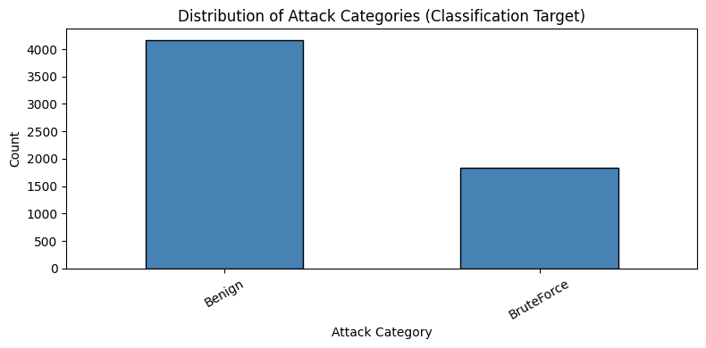
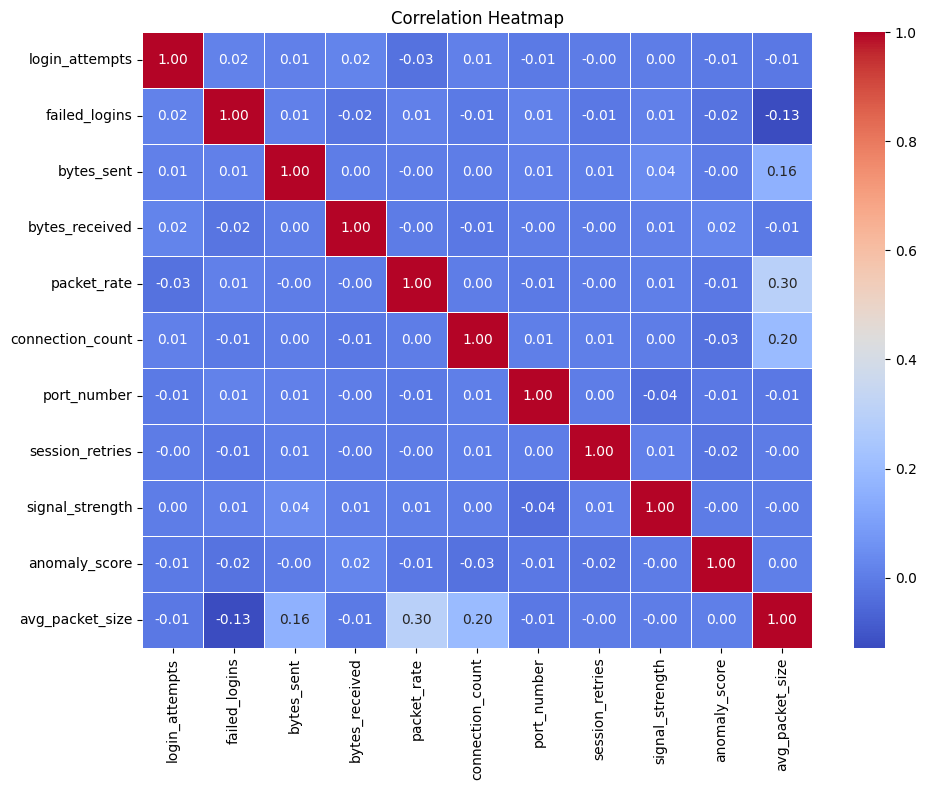
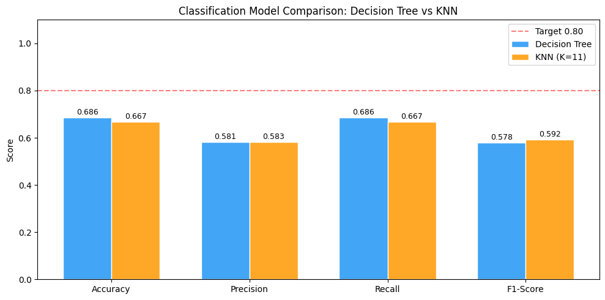
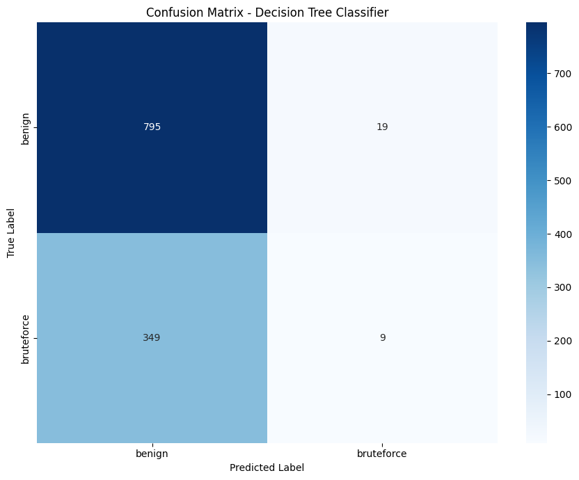
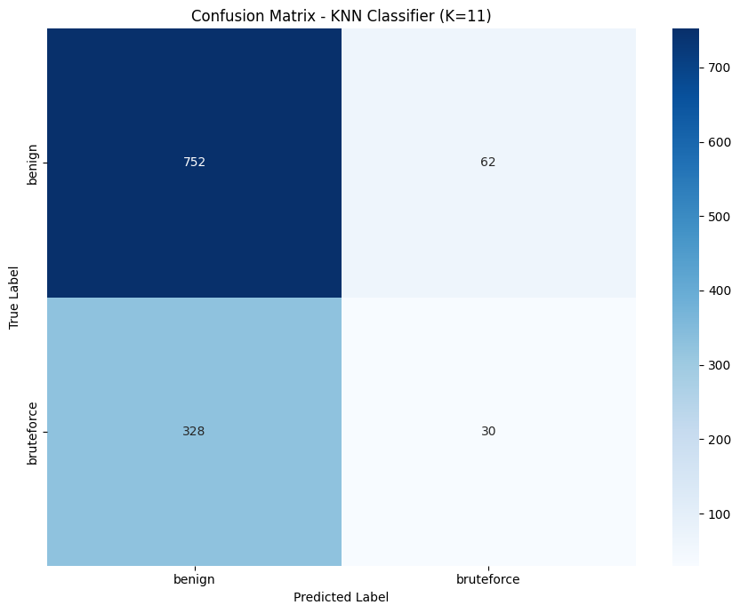
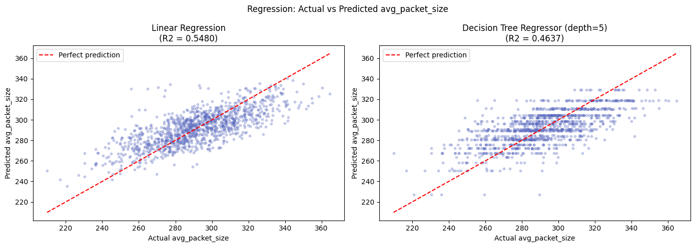
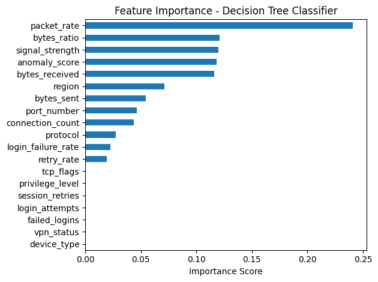

# Cyberattack Detection with Machine Learning

An end-to-end data science project that analyses 6,000 network sessions for a financial organisation that has suffered costly cyberattacks. Following the **Cross-Industry Standard Process for Data Mining (CRISP-DM)** framework, it tackles two tasks:

- **Classification:** label each session as `Benign` or `BruteForce` (`attack_category`)
- **Prediction (regression):** estimate the average packet size of a session (`avg_packet_size`)

Built as the individual project for *Fundamentals of AI & Data Science* (COMP H2706) at TU Dublin. The brief put the emphasis on understanding the data and explaining findings in a cybersecurity context, rather than on chasing the highest model score.


---

## 📂 Repository Structure

```
CyberattackDetectionML/
├── Cyberattack_Detection.ipynb      # Full analysis: code, outputs and markdown explanations
├── data/
│   └── Dataset2_odd_students.csv    # 6,000 network sessions × 19 columns
├── documentation/
│   └── Project_Report_B00168689.pdf # Written report
├── images/                          # Charts exported from the notebook
└── requirements.txt
```

📄 The full [Project Report (PDF)](documentation/Project%20Report.pdf) is viewable in-repo.

---

## 🗂️ Dataset

Each row is one network session. The dataset was provided for the module and is synthetically generated to mirror real-world cybersecurity patterns.

| Group | Columns |
|-------|---------|
| Network identifiers | `protocol`, `tcp_flags`, `port_number`, `vpn_status`, `region`, `device_type` |
| Login behaviour | `login_attempts`, `failed_logins`, `privilege_level` |
| Traffic volume | `bytes_sent`, `bytes_received`, `packet_rate`, `connection_count`, `session_retries`, `signal_strength` |
| Risk | `anomaly_score` (0–1) |
| **Targets** | `attack_category` (classification), `avg_packet_size` (prediction) |

**Data quality issues found during exploration:**

- 420 missing values (7%) in each of `protocol`, `bytes_received` and `signal_strength`
- Inconsistent labels in `protocol` (`TCP` and `tcp`, `UDP` and `udp`)
- 1,109 rows where `failed_logins` exceeded `login_attempts`, and 144 rows where `session_retries` exceeded `connection_count`
- Class imbalance: 69.4% `Benign` vs 30.6% `BruteForce`
- Outliers across several columns, most notably `port_number` (1,265) and `session_retries` (375)

<p align="center">
  
  
</p>

---

## 🔄 Approach (CRISP-DM)

**1. Business Understanding:** Detect brute-force activity in network traffic before it causes damage. Because a missed attack (false negative) costs a financial organisation far more than a false alarm (false positive), recall was treated as the main classification metric, with F1-score as a check on alarm fatigue.

**2. Data Understanding:** Descriptive statistics, duplicate and missing-value checks, impossible-value checks, and eight exploratory plots: histograms, boxplots, a target bar chart, feature-vs-target boxplots, a protocol countplot, a scatter plot, a correlation heatmap and a bivariate analysis.

**3. Data Preparation:**

- Lowercased and stripped all text columns to merge duplicate protocol labels
- Set impossible values to null, then handled missing data column by column:
  - `session_retries` (2.4% missing): rows dropped, leaving **5,856 rows**
  - `protocol`: imputed with the mode (`tcp`)
  - `bytes_received`, `signal_strength`: imputed with the mean (symmetric distributions)
  - `failed_logins`: imputed with the median (skewed distribution)
- Outliers **capped** with the IQR method rather than removed, since extreme traffic values are genuine session behaviour. The prediction target was left uncapped.
- Dropped `packet_session_id` (a unique identifier with no predictive value); zero-variance and near-constant checks found nothing else to drop
- **Engineered three features:**
  - `login_failure_rate` = `failed_logins / (login_attempts + 1)`: scale of brute-force attempts
  - `bytes_ratio` = `bytes_sent / (bytes_received + 1)`: possible data exfiltration
  - `retry_rate` = `session_retries / (connection_count + 1)`: possible port-scanning behaviour
- `LabelEncoder` on the six categorical features, with the classification target encoded separately so predictions can be decoded
- 80/20 train/test split (stratified for classification) and `MinMaxScaler` fitted on training data only, to prevent data leakage

**4. Modelling:**

| Task | Baseline | Second model | Ruled out (and why) |
|------|----------|--------------|---------------------|
| Classification | Decision Tree (`max_depth=5`) | KNN (K tested from 3 to 11, K=11 selected) | Naive Bayes (features mostly numeric and not independent), Logistic Regression (scatter plot showed no linear class boundary) |
| Prediction | Linear Regression | Decision Tree Regressor (`max_depth` tested at 3, 5, 7 and 10; 5 selected) | Naive Bayes and Logistic Regression (classification only), KNN (no feature importance to interpret) |

**5. Evaluation:** Hold-out test set plus 5-fold cross-validation, with accuracy, precision, recall, F1-score and confusion matrices for classification, and RMSE, MAE and R² for prediction.

---

## 📊 Results

### Classification: `attack_category`

| Metric | Decision Tree (depth=5) | KNN (K=11) |
|--------|:-----------------------:|:----------:|
| Train Accuracy | 0.7047 | 0.6992 |
| Test Accuracy | **0.6860** | 0.6672 |
| Precision (weighted) | 0.5808 | **0.5832** |
| Recall (weighted) | **0.6860** | 0.6672 |
| F1-Score (weighted) | 0.5782 | **0.5923** |
| 5-fold CV F1 | 0.5752 ± 0.0040 | 0.5905 ± 0.0080 |
| BruteForce-class recall | 0.03 (9 of 358) | 0.08 (30 of 358) |

<p align="center">
  
</p>
<p align="center">
  
  
</p>

### Prediction: `avg_packet_size`

| Model | RMSE | MAE | R² |
|-------|:----:|:---:|:--:|
| Linear Regression | **15.7830** | **12.2665** | **0.5480** |
| Decision Tree Regressor (depth=5) | 17.1917 | 13.5788 | 0.4637 |

<p align="center">
  
</p>

---

## 💡 Key Findings

- **Top attack-detection features** (Decision Tree importance): `packet_rate`, `bytes_ratio`, `signal_strength`, `anomaly_score` and `bytes_received`. The engineered `bytes_ratio` ranked second, which shows that features built from domain knowledge added signal the raw columns didn't capture on their own.
- **Linear Regression beat the Decision Tree Regressor on all three metrics**, explaining 54.8% of the variance in `avg_packet_size`. The simpler model avoided fitting the noise that the deeper tree picked up.
- **`avg_packet_size` is only weakly predictable from these features.** The strongest single correlation was with `packet_rate` (r ≈ 0.30), so the ceiling seems to come from the dataset rather than from the choice of model.
- **Attack detection is limited by class imbalance.** Both classifiers stayed close to the 69.4% accuracy you would get by always predicting `Benign`, and both caught only a small share of BruteForce sessions.

<p align="center">
  
</p>

---

## ▶️ How to Run

```bash
git clone https://github.com/RoisinAylward/CyberattackDetectionML.git
cd CyberattackDetectionML
pip install -r requirements.txt
jupyter notebook Cyberattack_Detection.ipynb
```

The notebook was developed in Google Colab ([original Colab version](https://colab.research.google.com/drive/1bENmfJZ5B1Kda-ZkjQZVkW_LqYcogExn?usp=sharing)). To run this repo's version in Colab, first create a `data/` folder in the Colab file browser and upload `cyberattack_sessions.csv` into it.

---

## 🛠️ Tech Stack

**Python 3** · **pandas** · **NumPy** · **scikit-learn** (`DecisionTreeClassifier`, `KNeighborsClassifier`, `LinearRegression`, `DecisionTreeRegressor`, `LabelEncoder`, `MinMaxScaler`, `cross_val_score`) · **Matplotlib** · **seaborn** · **Jupyter / Google Colab**
